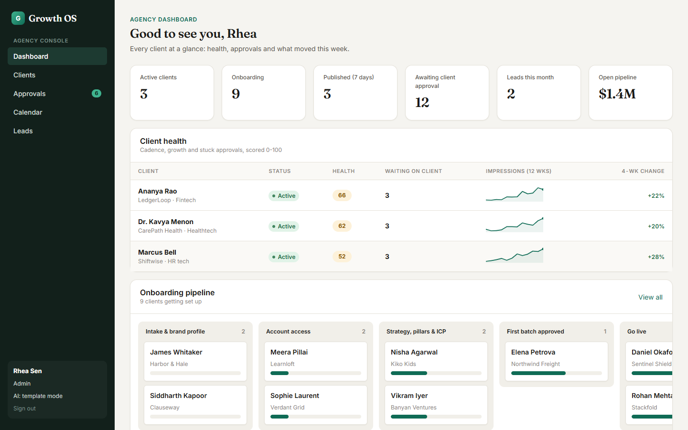
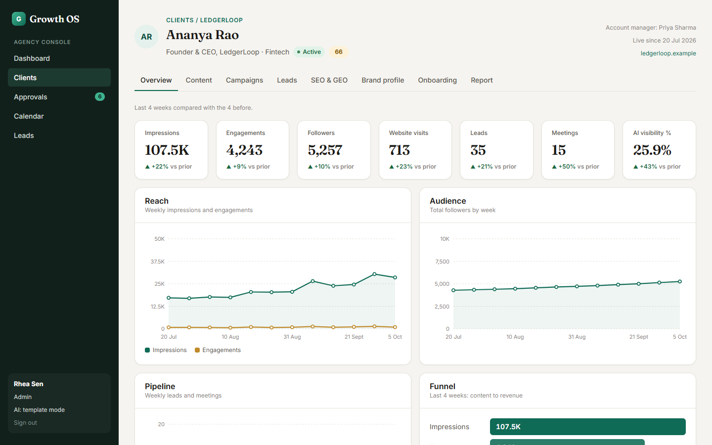
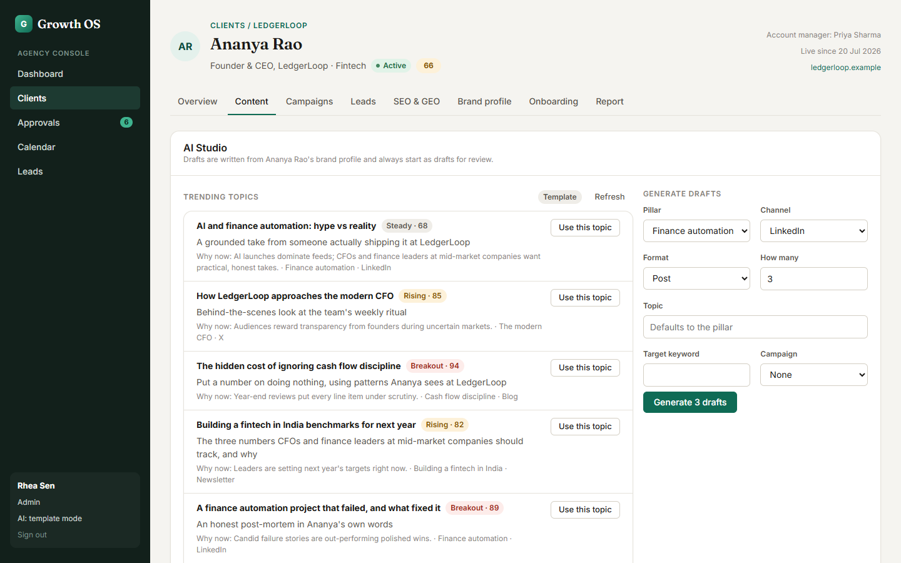
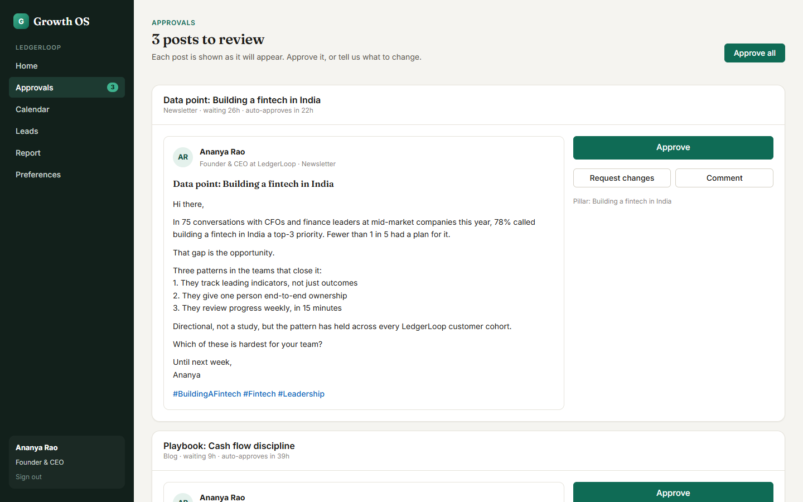
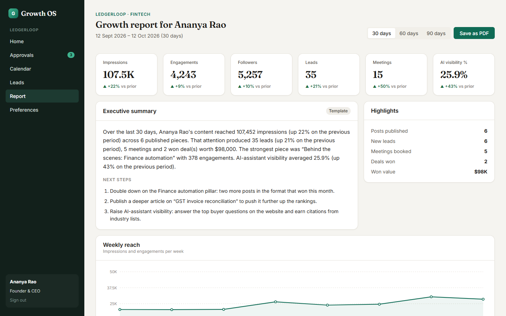

# Growth OS

Growth OS is the portal for a done-for-you growth agency. The agency team runs content marketing, personal branding, lead generation and SEO/GEO for busy founders and executives. Clients don't do the work: they approve content and see results.

One app serves both sides:

- **Team console**: strategists onboard clients, draft content with AI in each client's voice, run the approval workflow, manage campaigns and leads, track SEO and AI-assistant visibility, and send monthly reports.
- **Client portal**: founders see what needs their approval, approve or request changes in a couple of clicks, and follow results.



## Contents

- [Features](#features)
- [Quick start](#quick-start)
- [Demo credentials](#demo-credentials)
- [5-minute demo walkthrough](#5-minute-demo-walkthrough)
- [Turning on real AI](#turning-on-real-ai)
- [What's simulated](#whats-simulated)
- [Testing](#testing)
- [Environment variables](#environment-variables)
- [Project structure](#project-structure)
- [Roadmap](#roadmap)

## Features

| Module | What it does |
| --- | --- |
| **Client onboarding** | Three-step "new client" wizard (basics → brand profile → channels, cadence and auto-approve) that can create the client's login with a one-time temporary password. A five-step onboarding checklist; completing it takes the client live. |
| **Content & personal branding** | Content board by status, AI Studio with trending topics ("use this topic") and draft generation per pillar, channel, format, topic and keyword. Every draft is written from the client's brand brief and shows whether it came from an LLM or the template fallback. Repurpose any piece into another channel. |
| **Approval layer** | Server-enforced state machine: idea → draft → internal review → client review → approved → scheduled → published, with changes requested and pull-back paths. Full audit trail, comments, bulk "Approve all", and optional auto-approve after N hours. |
| **Campaigns** | Content, personal-brand, lead-gen and performance campaigns with KPI targets and progress computed from real content and leads. |
| **Lead generation** | Pipeline board by stage, leads attributed to the post and campaign that produced them, and AI outreach drafts (connection note, follow-up, meeting request) with copy to clipboard. |
| **Performance (SEO + GEO)** | Keyword tracking with rank changes, AI keyword ideas you can add in one click, and GEO checks: do ChatGPT, Perplexity, Gemini and Claude name the client when a buyer asks? |
| **Impact & reporting** | Agency dashboard with client health scores, onboarding pipeline, approvals waiting and an activity feed. Client impact view (KPIs vs the prior period, trends, funnel, top posts, keyword movers, GEO by engine). A printable monthly report with an AI executive summary and next steps ("Save as PDF"). |

<table>
  <tr>
    <td></td>
    <td></td>
  </tr>
  <tr>
    <td></td>
    <td></td>
  </tr>
</table>

### Roles

| Role | Who | Can do |
| --- | --- | --- |
| `admin` | Agency lead | Everything, across all clients. |
| `strategist` | Account managers and writers | Everything, across all clients. |
| `client` | The founder or executive | Their own account only: approve or request changes, comment, view calendar, leads and reports, edit brand preferences and auto-approve. Never sees internal drafts. |

Tenant isolation is enforced on the server: every client-scoped route checks access, and list endpoints pin client users to their own account.

### Tech stack

| Layer | Technology |
| --- | --- |
| Backend | Python 3.11+, FastAPI, Pydantic v2, Uvicorn |
| Database | SQLAlchemy 2.0; SQLite locally, Postgres via `DATABASE_URL` |
| Auth | JWT (HS256, PyJWT), PBKDF2-SHA256 password hashing (stdlib) |
| AI | Anthropic Messages API or OpenAI via httpx, with deterministic templates when no key is set |
| Frontend | React 19, TypeScript, Vite. No router or chart libraries: a small hash router and hand-built SVG charts |
| Tests | pytest with FastAPI's TestClient; an end-to-end API smoke test |

## Quick start

Prerequisites: Python 3.11+, Node.js 20.19+ (or 22.12+) with npm, and Git.

```bash
git clone https://github.com/KapilPushkar/growth-os.git
cd growth-os
```

### 1. Backend (terminal 1)

**macOS / Linux**

```bash
cd backend
python3 -m venv .venv
source .venv/bin/activate
pip install -r requirements-dev.txt
cp .env.example .env
python -m app.seed                       # creates growth_os.db with demo data
uvicorn app.main:app --reload --port 8000
```

**Windows (PowerShell)**

```powershell
cd backend
python -m venv .venv
.\.venv\Scripts\Activate.ps1
pip install -r requirements-dev.txt
Copy-Item .env.example .env
python -m app.seed                       # creates growth_os.db with demo data
uvicorn app.main:app --reload --port 8000
```

> If PowerShell blocks `Activate.ps1`, run `Set-ExecutionPolicy -Scope CurrentUser RemoteSigned` once, then activate again.

`python -m app.seed` drops and recreates every table, so run it again whenever you want a clean demo. It prints the demo credentials when it finishes.

### 2. Frontend (terminal 2)

Same on every OS:

```bash
cd frontend
npm install
npm run dev
```

Open **http://localhost:5173**. The Vite dev server forwards `/api/*` to the backend on port 8000. Interactive API docs are at **http://localhost:8000/docs**.

### Production-style run (one process)

```bash
cd frontend && npm run build && cd ..
cd backend && uvicorn app.main:app --port 8000
```

FastAPI serves the built app from `frontend/dist` at http://localhost:8000, with a fallback to `index.html` for client-side routes.

## Demo credentials

Created by `python -m app.seed`:

| Email | Password | Role | Notes |
| --- | --- | --- | --- |
| `admin@growthos.dev` | `admin123` | Admin | Rhea Sen, agency lead |
| `priya@growthos.dev` | `team123` | Strategist | Account manager for odd-numbered clients |
| `arjun@growthos.dev` | `team123` | Strategist | Account manager for even-numbered clients |
| `client1@growthos.dev` | `client123` | Client | Ananya Rao, LedgerLoop (fintech). Live, 48h auto-approve on |
| `client2@growthos.dev` | `client123` | Client | Marcus Bell, Shiftwise (HR tech). Live, approvals waiting over 48h |
| `client3@growthos.dev` | `client123` | Client | Dr. Kavya Menon, CarePath Health (healthtech). Live |
| `client4@growthos.dev` … `client12@growthos.dev` | `client123` | Client | Nine clients at different onboarding steps (B2B SaaS, logistics, VC, climate, legal tech, D2C, cybersecurity, edtech, real estate) |

All people and companies are fictional; company sites use the reserved `.example` domain.

## 5-minute demo walkthrough

This follows the same story as the automated smoke test.

1. **Agency view (admin).** Sign in as `admin@growthos.dev`. The dashboard shows three live clients with health scores and 12-week sparklines, nine clients in the onboarding pipeline, and an activity feed. LedgerLoop's oldest post has already been **auto-approved**: it waited past the client's 48-hour window.
2. **Onboard a client.** Go to **Clients → New client**, fill the three steps and keep "Create a client login" ticked. Copy the temporary password shown once. On the **Onboarding** tab tick all five steps: the client goes **live**.
3. **Draft with AI.** Open the new client's **Content** tab. In AI Studio click **Use this topic** on a trending topic, then **Generate 3 drafts**. The badge shows *Template* (or *AI · Anthropic* with a key). Open a draft, edit it, **Submit for review**, then **Send to client**. Send a second draft straight to the client too.
4. **Client approves.** In a private window, sign in with the new client's email and temporary password (or use `client1@growthos.dev`). Home says how many posts need approval. On **Approvals**, each post is previewed as it will look on LinkedIn or X. **Approve** one; **Request changes** on another (a note is required).
5. **Team finishes the loop.** Back as admin, open **Approvals**: the changed post is in *Changes requested*. Open it, **Move to draft**, edit, **Send to client**, then **Approve** on the client's behalf, **Schedule** with the date picker, and **Mark published**. The timeline shows every step: who, when, from → to, and notes.
6. **Results.** On the published post click **Sync metrics** (simulated). In **Leads**, **Add lead** with that post as the source, then move it to *Meeting booked*. Use **Draft message** in the lead drawer for an AI outreach note.
7. **Impact and report.** Open LedgerLoop (client 1): **Overview** shows KPIs vs the prior four weeks, trends, the funnel and GEO visibility. **Report** has the executive summary and next steps; **Save as PDF** prints a clean report.
8. **Isolation.** As a client, try `#/clients/2` or another client's data: the server returns 403 and the portal only shows that client's own account.

## Turning on real AI

AI works out of the box with built-in templates. To use a live model:

1. Copy `backend/.env.example` to `backend/.env` (if you haven't already).
2. Set `ANTHROPIC_API_KEY` (preferred) or `OPENAI_API_KEY`. Optionally change `ANTHROPIC_MODEL` / `OPENAI_MODEL`.
3. Restart the backend. The sidebar shows the active provider, and every AI result is labelled `llm:anthropic`, `llm:openai` or `template`.

Any provider error, timeout or unparseable reply falls back to templates, so AI endpoints never fail a request. AI drafts always start as `draft` and go through approval.

## What's simulated

The MVP is honest about what is not connected yet. Simulated results are labelled in the API (`method: "simulated"`) and in the UI.

| Simulated | Why / what replaces it |
| --- | --- |
| Publishing to LinkedIn / X | "Mark published" records the post and time; no API post yet. |
| Post metrics sync | Adds plausible impressions, engagements, clicks and occasional leads. Replace with LinkedIn/X analytics. |
| Keyword rank refresh | Nudges ranks up or down. Replace with a rank-tracking provider. |
| Keyword search volume (template mode) | Estimates; labelled as such. |
| GEO checks | Live only for the engine matching your key (`claude` → Anthropic, `chatgpt` → OpenAI); others are simulated, weighted by the client's current AI visibility. |
| History | 12 weeks of metric snapshots and past posts come from the seed. |

## Testing

```bash
# Backend unit and API tests (temporary SQLite DB, no AI keys needed)
cd backend
pytest

# End-to-end smoke test against a running, freshly seeded backend
python -m app.seed
uvicorn app.main:app --port 8000          # in another terminal
python ../scripts/smoke_test.py           # or: python ../scripts/smoke_test.py http://host:8000

# Frontend lint and type-checked production build
cd frontend
npm run lint
npm run build
```

The tests cover login and 401s, tenant isolation (403s for another client's data and for team-only routes), the full approval state machine (happy path, 409 for invalid transitions, 403 for the wrong role, 400 for a missing note), auto-approve before and after the threshold, the AI layer with no keys and with failing or malformed provider replies, and the seed.

## Environment variables

Set in `backend/.env` (see `backend/.env.example`).

| Name | Purpose | Default |
| --- | --- | --- |
| `DATABASE_URL` | SQLAlchemy URL. Relative SQLite paths resolve against `backend/`. Use a Postgres URL in production. | `sqlite:///./growth_os.db` |
| `JWT_SECRET` | Signs auth tokens. **Replace outside local dev.** | dev-only value |
| `JWT_EXPIRE_MINUTES` | Token lifetime. | `720` |
| `ANTHROPIC_API_KEY` | Enables Anthropic generation (used first). | *(blank)* |
| `ANTHROPIC_MODEL` | Anthropic model. | `claude-opus-5-5` |
| `OPENAI_API_KEY` | Enables OpenAI generation when no Anthropic key is set. | *(blank)* |
| `OPENAI_MODEL` | OpenAI model. | `gpt-4o-mini` |
| `AI_TIMEOUT_SECONDS` | Timeout for provider calls before falling back. | `60` |
| `AI_EFFORT` | Anthropic reasoning effort (`low`, `medium`, `high`). | `low` |
| `CORS_ORIGINS` | Comma-separated origins allowed to call the API. | `http://localhost:5173` |

## Project structure

```text
growth-os/
├── backend/
│   ├── app/
│   │   ├── main.py            # FastAPI app, routers, error mapping, serves the SPA build
│   │   ├── config.py          # settings from the environment
│   │   ├── database.py        # engine, sessions, Base
│   │   ├── models.py          # SQLAlchemy models + vocabularies
│   │   ├── schemas.py         # validated request bodies
│   │   ├── serializers.py     # model -> JSON
│   │   ├── auth.py            # hashing, JWT, access helpers
│   │   ├── services.py        # approval state machine, auto-approve, health score
│   │   ├── analytics.py       # dashboard, impact and report computations
│   │   ├── ai.py              # LLM providers + template fallback
│   │   ├── post_templates.py  # post frameworks used by the seed and the fallback
│   │   ├── seed.py            # demo data (python -m app.seed)
│   │   └── routers/           # auth, clients, content + approvals, campaigns, leads, seo + geo, ai, analytics
│   ├── tests/                 # pytest suite
│   ├── requirements.txt
│   └── requirements-dev.txt
├── frontend/
│   └── src/
│       ├── lib/               # typed API client, hash router, types, formatters, hooks
│       ├── components/        # layout, UI kit, charts, content editor, leads, calendar, report
│       └── pages/             # team console and client portal screens
├── scripts/smoke_test.py      # end-to-end API walkthrough
└── docs/
    ├── ARCHITECTURE.md        # design: modules, data model, workflow, API, AI layer
    ├── DECISIONS.md           # choices made where the design left room
    └── screenshots/
```

More detail: [docs/ARCHITECTURE.md](docs/ARCHITECTURE.md) for the design and [docs/DECISIONS.md](docs/DECISIONS.md) for the choices made while building it.

## Roadmap

- [x] Repo & skeleton
- [x] Data model & auth
- [x] Clients & onboarding
- [x] Content + approval workflow
- [x] AI content generation
- [x] Campaigns
- [x] Leads
- [x] SEO/GEO
- [x] Dashboards & reports
- [x] Seed data (12 demo clients)
- [ ] Real publishing and analytics (LinkedIn / X APIs, Search Console, rank tracking)
- [ ] CRM sync (HubSpot / Salesforce)
- [ ] Background jobs for scheduled publishing, auto-approve and weekly snapshots
- [ ] Per-client team assignment, SSO and audit export
- [ ] Email / Slack nudges when approvals are waiting
- [ ] Alembic migrations

## License

[MIT](LICENSE) © 2026 Kapil Pushkar
