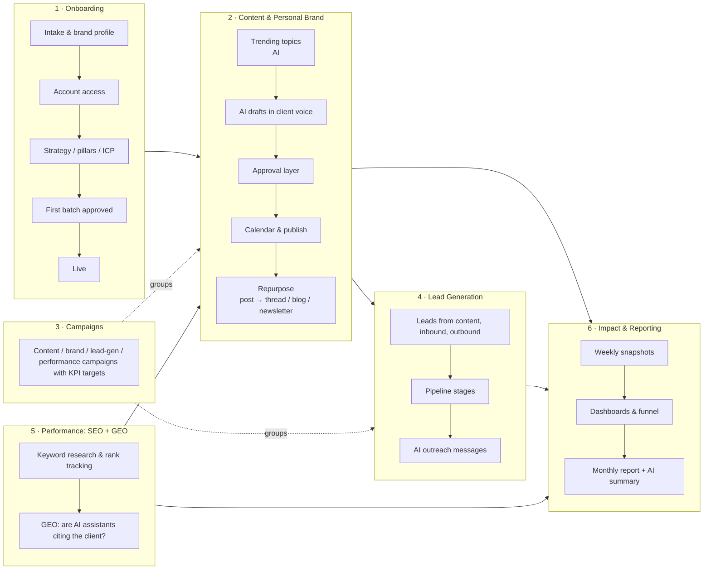
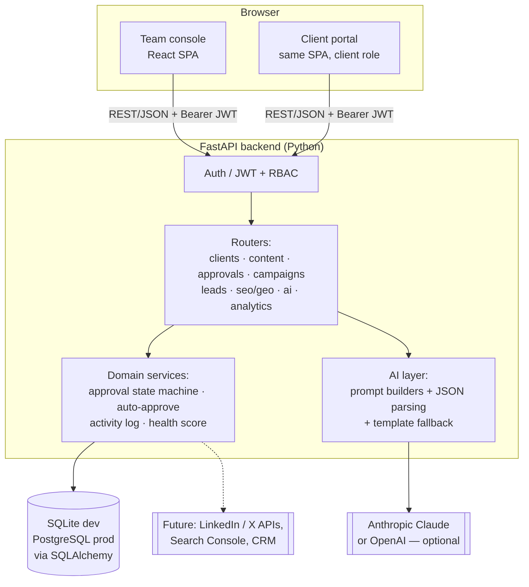
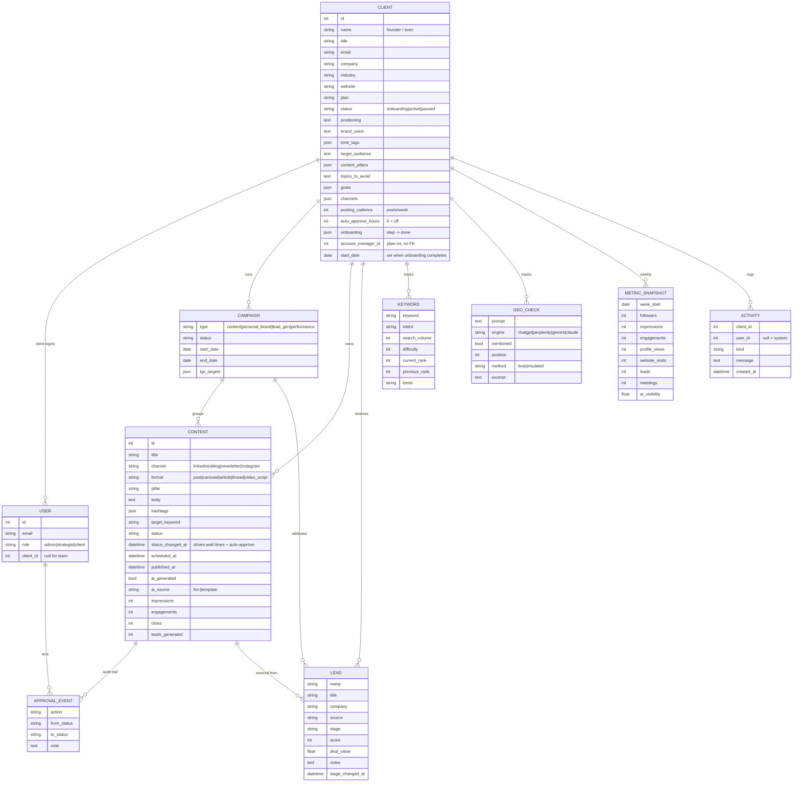
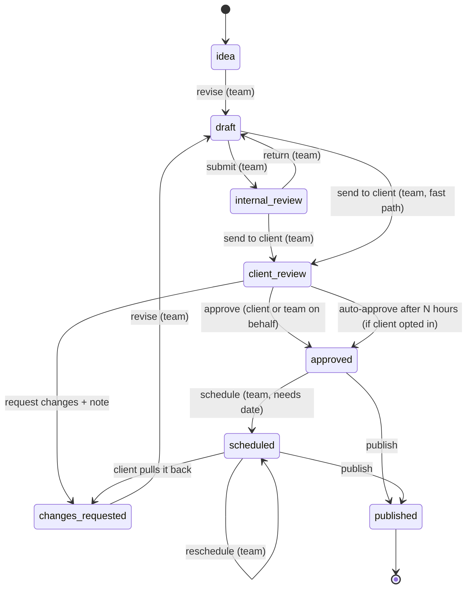

# Growth OS — Architecture

> A done-for-you growth portal: the agency team runs content marketing, personal branding, lead generation and SEO/GEO for busy founders and executives. Clients only review, approve and see results.

Status: **draft for sign-off** · Scope: MVP to onboard the first 12 clients next month

---

## 1. Problem → design principles

| Problem statement says | What it means for the design |
|---|---|
| "Done-for-you, clients shouldn't touch anything" | Two very different interfaces. The **team console** does all the work. The **client portal** is read-mostly with exactly two actions: approve or request changes. Optional auto-approve after N hours. |
| "Content marketing, personal branding, lead generation" | Four service modules sharing one client record and brand profile: Content & Brand, Campaigns, Lead Gen, Performance (SEO + GEO). |
| "One platform, end to end" | Single backend + single database. Every module keys off `client_id`, so a post → its impressions → the lead it produced → the meeting → won revenue can be traced in one place. |
| "12 clients, onboard next month" | First-class **onboarding pipeline** (5 steps) and a brand-profile intake that feeds every AI prompt. Built multi-tenant from day one. |
| "Show we are making an impact" | Weekly metric snapshots per client, before/after deltas, a lead funnel, AI-visibility tracking, and a one-click monthly report with an AI-written executive summary. |

## 2. Users and roles

| Role | Who | Can do |
|---|---|---|
| `admin` | Agency lead | Everything, across all clients |
| `strategist` | Account managers, writers | Everything, across all clients (MVP — per-client assignment is shown but not enforced) |
| `client` | The founder / exec (or their EA) | See only their own account: approve / request changes, comment, view calendar, leads, reports; edit brand preferences and auto-approve setting |

Clients never see internal drafts (`idea`, `draft`, `internal_review`).

## 3. Functional modules



Mapping of your notes:

| Note | Where it lives |
|---|---|
| Lead generation | Lead Gen module: pipeline board, sources (content / inbound / outbound / referral), AI outreach drafts, leads linked back to the post that produced them |
| Personal branding | Brand profile (voice, tone, pillars, audience, topics to avoid) + LinkedIn/X content |
| What social content we want / what to post | Content pillars, posting cadence per client, AI "trending topics" with the client's angle and *why now* |
| Approval layer | State machine below, full audit trail, bulk approve, auto-approve |
| Content marketing campaigns | Campaigns with type, channels, dates, KPI targets and progress |
| Performance marketing — trending keywords, SEO, GEO | Keyword tracker (volume, difficulty, rank, trend), AI keyword suggestions, GEO prompt checks across ChatGPT / Perplexity / Gemini / Claude |
| Show we're making an impact | Client impact dashboard, agency dashboard with client health, monthly report |

## 4. System architecture



**Tech stack**

| Layer | Choice | Why |
|---|---|---|
| Frontend | React 19 + TypeScript + Vite | Fast to build, typed API contracts. No router/chart libraries — a tiny hash router and SVG charts keep installs to 4 packages. |
| Backend | FastAPI + Pydantic v2 | Typed request validation, auto OpenAPI docs at `/docs`, Python fits the data/AI work. |
| ORM / DB | SQLAlchemy 2.0; SQLite locally, Postgres in prod by changing `DATABASE_URL` | Zero-setup local run; production-ready path. JSON columns for list fields (pillars, channels). |
| Auth | JWT (HS256) bearer tokens, PBKDF2 password hashing (stdlib) | No external auth service needed for MVP. |
| AI | Anthropic Messages API (preferred) or OpenAI via `httpx`; deterministic templates when no key | Demo always works offline; real generation when a key is set. Every AI response is tagged `llm:<provider>` or `template`. |
| Deploy (later) | One container: FastAPI serves the built SPA from `frontend/dist`; managed Postgres | Single process, cheap to host. |

## 5. Data model



## 6. Approval layer (content state machine)



Rules enforced on the server (`services.TRANSITIONS`): allowed from-states, target state and which roles may act. Every transition and comment writes an `approval_event` (who, when, from → to, note) and an `activity` row for the feed. "Request changes" requires a note. Bulk approve exists for the client inbox. Auto-approval is evaluated lazily whenever queues/dashboards load — no scheduler needed for the MVP.

## 7. API surface (REST, all under `/api`)

| Area | Endpoints |
|---|---|
| Auth | `POST /auth/login` · `GET /auth/me` · `GET /users` (team) |
| Clients | `GET/POST /clients` · `GET/PATCH /clients/{id}` · `POST /clients/{id}/onboarding` |
| Content | `GET/POST /content` (filters: client, status, channel, campaign, date range) · `GET/PATCH/DELETE /content/{id}` · `POST /content/{id}/transition` · `POST /content/bulk-transition` · `POST /content/{id}/sync-metrics` |
| Approvals | `GET /approvals` (team: internal / client / changes buckets; client: their inbox) |
| Campaigns | `GET/POST /campaigns` · `GET/PATCH/DELETE /campaigns/{id}` (with KPI progress) |
| Leads | `GET/POST /leads` · `GET /leads/pipeline` · `PATCH/DELETE /leads/{id}` |
| SEO / GEO | `GET/POST /keywords` · `POST /keywords/bulk` · `POST /keywords/refresh` · `DELETE /keywords/{id}` · `GET /geo` · `POST /geo/run` |
| AI | `GET /ai/status` · `POST /ai/generate-content` · `POST /ai/topics` · `POST /ai/keywords` · `POST /ai/outreach` · `POST /ai/repurpose` |
| Analytics | `GET /dashboard` (agency) · `GET /clients/{id}/impact` · `GET /clients/{id}/report?days=30` |

Interactive docs at `http://localhost:8000/docs`.

**Access control:** team routes use `require_team`; shared routes call `ensure_client_access(user, client_id)`, and list endpoints force `client_id = user.client_id` for client users, so tenant isolation is enforced on the server, not in the UI.

## 8. AI layer

One module (`app/ai.py`) owns all prompting:

- Every prompt starts from the client's **brand brief** (voice, tone, pillars, audience, goals, topics to avoid), so output sounds like that founder.
- Responses are requested as JSON and parsed defensively; any failure (no key, timeout, quota, bad JSON) falls back to templates built from the same brand data. The UI shows a badge saying which was used.
- Capabilities: post drafts per channel rules, trending topics with *why now*, keyword ideas, repurposing, outreach messages, report executive summary, live GEO check (asks the LLM the buyer's question and checks whether the client is named).
- Humans stay in the loop: AI output always lands as a `draft` and must pass the approval layer.

## 9. Impact measurement

- **Weekly `metric_snapshot` per client** — followers, impressions, engagements, profile views, website visits, leads, meetings, AI visibility %.
- **Client impact view** — last 4 weeks vs previous 4 (deltas), trend charts, funnel *impressions → engagements → leads → meetings → won*, top posts, keyword movers, GEO visibility by engine.
- **Agency dashboard** — all clients with health score (cadence hit, growth, stuck approvals), onboarding progress, approvals waiting, activity feed.
- **Monthly report** — printable page with KPIs and AI-written summary + next steps.

## 10. What is real vs simulated in the MVP

| Real (working end to end) | Simulated (clearly labelled, swap for integrations later) |
|---|---|
| Auth, roles, tenant isolation | Publishing to LinkedIn / X (marking "published" records it; no API post) |
| All CRUD, approval workflow, audit trail, auto-approve | Post metrics sync (random but plausible numbers) |
| Onboarding pipeline and brand profiles | Search volume / rank refresh (no SEO data provider) |
| AI generation (with a key) + template fallback | GEO checks for engines without a key |
| Dashboards, funnel, reports computed from DB | 12 weeks of historical snapshots in seed data |

## 11. Repository layout

```
growth-os/
├── backend/
│   ├── app/
│   │   ├── main.py            # FastAPI app, CORS, routers, serves SPA build
│   │   ├── config.py          # env settings
│   │   ├── database.py        # engine, session
│   │   ├── models.py          # SQLAlchemy models + vocabularies
│   │   ├── schemas.py         # Pydantic request bodies
│   │   ├── serializers.py     # model -> JSON
│   │   ├── auth.py            # JWT, hashing, RBAC helpers
│   │   ├── services.py        # approval state machine, auto-approve, activity
│   │   ├── analytics.py       # dashboard, impact and report computations
│   │   ├── ai.py              # LLM + template fallback
│   │   ├── post_templates.py  # deterministic post frameworks (seed + AI fallback)
│   │   ├── seed.py            # 12 demo clients + team + history
│   │   └── routers/           # auth, clients, content (+approvals), campaigns, leads, seo (+geo), ai, analytics
│   ├── requirements.txt
│   └── .env.example
├── frontend/
│   ├── src/
│   │   ├── api.ts             # typed fetch client
│   │   ├── router.tsx         # hash router
│   │   ├── components/        # charts, badges, modals, layout
│   │   └── pages/             # team console + client portal pages
│   ├── package.json
│   └── vite.config.ts         # proxies /api -> :8000
├── docs/ARCHITECTURE.md
└── README.md
```

## 12. Screens

**Team console:** Agency dashboard · Clients (list + onboarding wizard) · Client workspace (Overview/impact, Content board + AI studio, Campaigns, Leads, SEO & GEO, Brand profile, Onboarding, Report) · Approvals queue · Content calendar · Lead pipeline.

**Client portal:** Home (results at a glance + "needs your approval") · Approvals (approve / request changes / approve all) · Calendar · Leads · Monthly report · Preferences (brand voice, auto-approve).

## 13. Out of scope for the MVP → next steps

1. Real publishing and analytics via LinkedIn / X APIs, Search Console, a rank-tracking provider.
2. CRM sync (HubSpot / Salesforce) for leads.
3. Background jobs (Celery/RQ or a cron) for scheduled publishing, auto-approve, weekly snapshots.
4. Per-client team assignment enforcement, SSO, audit export.
5. Email / WhatsApp / Slack nudges to clients when approvals are waiting.
6. Alembic migrations once the schema settles.
